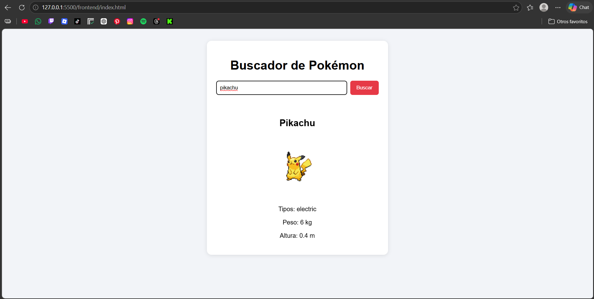
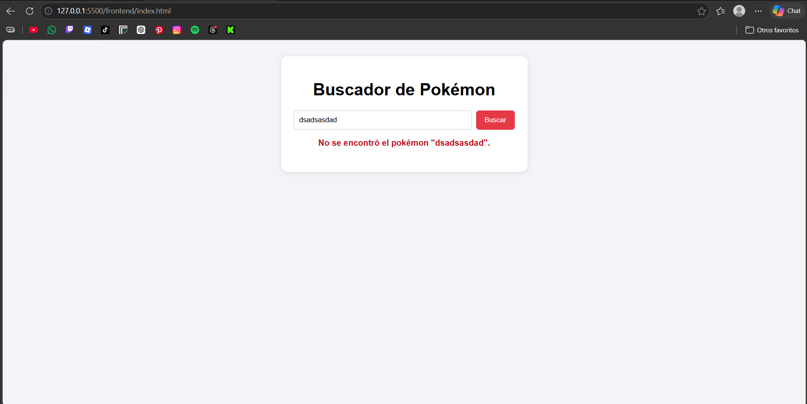

# Documentación de la Práctica 1 - Programación Web III

Este archivo resume el trabajo hecho en cada parte de la práctica.

## Estructura del proyecto

```
db/         schema.sql, seed.sql y consultas.sql
frontend/   index.html, styles.css y app.js
pokeapi/    carpeta reservada para el proyecto PokeAPI
docs/       documentación y capturas
```

## Parte 1: Git y GitHub

Cada parte se trabajó en su propia rama `feature/<número>-<descripción>`, con
commits en formato `tipo: descripción`. Cada rama entró a `main` mediante un
pull request con descripción, revisado en la pestaña Files changed antes del
merge.

## Parte 2: Base de datos SQL

- `db/schema.sql`: crea las 5 tablas (categorias, productos, clientes, pedidos
  y detalle_pedido) con claves primarias y foráneas.
- `db/seed.sql`: inserta 3 categorías, 12 productos, 6 clientes, 10 pedidos y
  25 líneas de detalle.
- `db/consultas.sql`: 7 consultas, cada una con un comentario de la pregunta
  que responde.

Para probarlo, ejecutar en orden `schema.sql`, `seed.sql` y `consultas.sql`
en phpMyAdmin (pestaña SQL).

## Parte 3: Métodos HTTP

La explicación de GET, POST, PUT, PATCH y DELETE, con ejemplos reales sobre
JSONPlaceholder, está en [metodos_http.md](metodos_http.md).

## Parte 4: Fetch a la PokeAPI

La página `frontend/index.html` busca un pokémon por nombre con
`https://pokeapi.co/api/v2/pokemon/{nombre}` y muestra nombre, imagen, tipos,
peso y altura. Usa async/await con try/catch, valida `response.ok`, muestra
"Cargando..." mientras responde y un mensaje claro si falla la petición o el
pokémon no existe. El peso (hectogramos) se convierte a kg y la altura
(decímetros) a metros.

Para usarla, abrir `frontend/index.html` en el navegador.

### Captura: pokémon encontrado



### Captura: error

